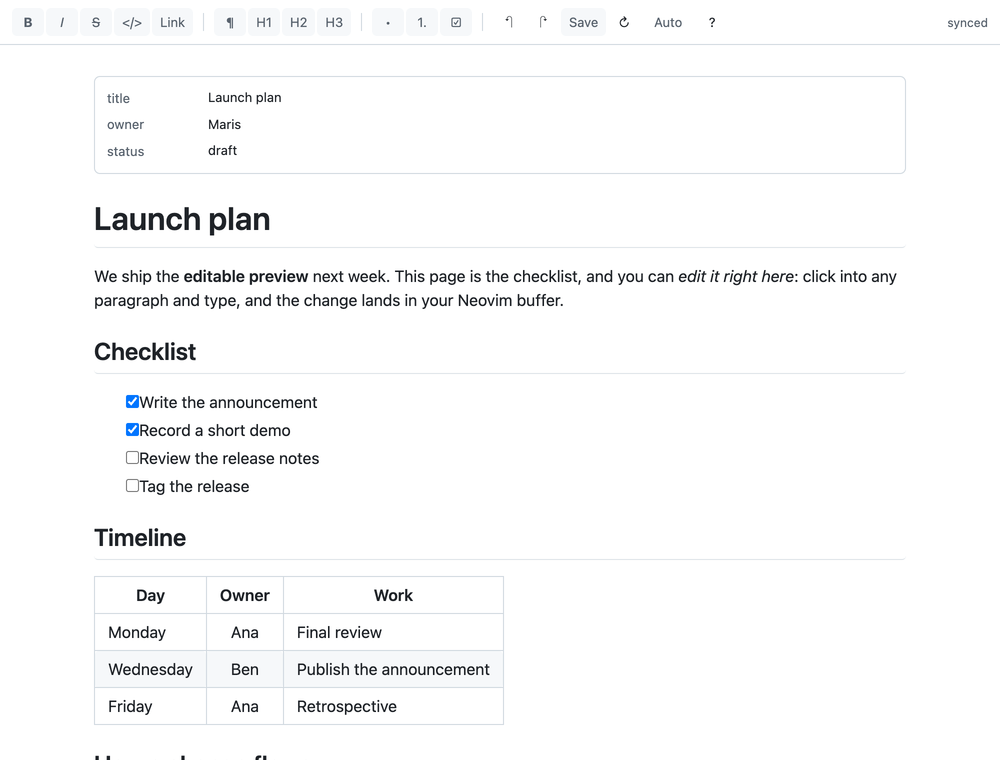
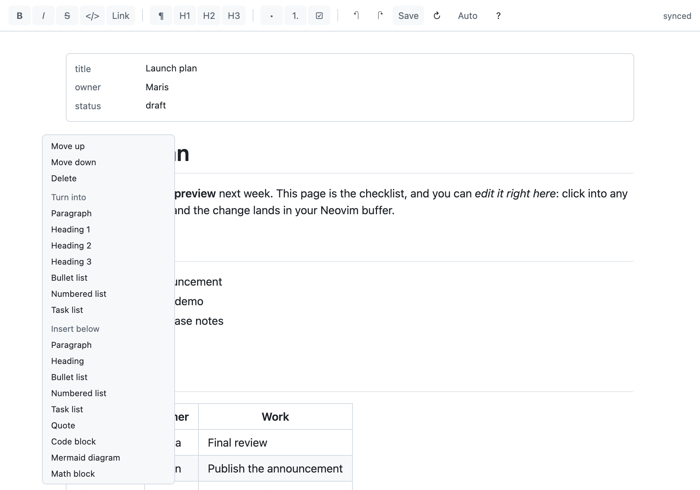
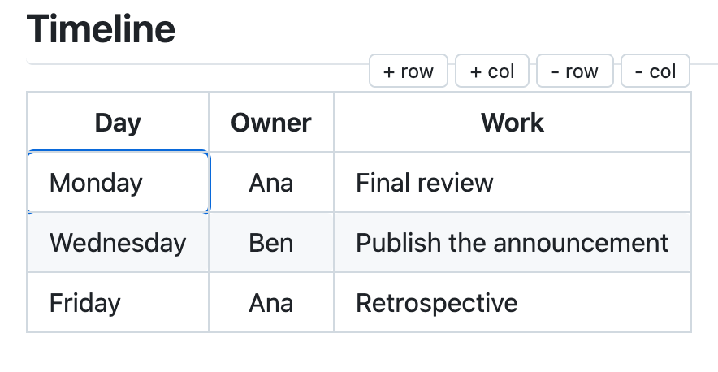
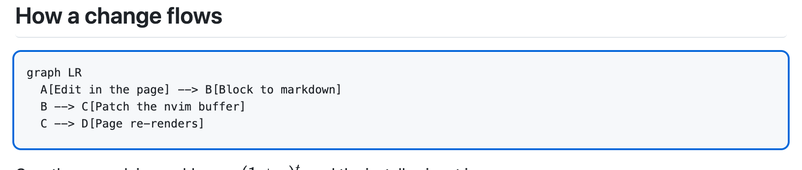
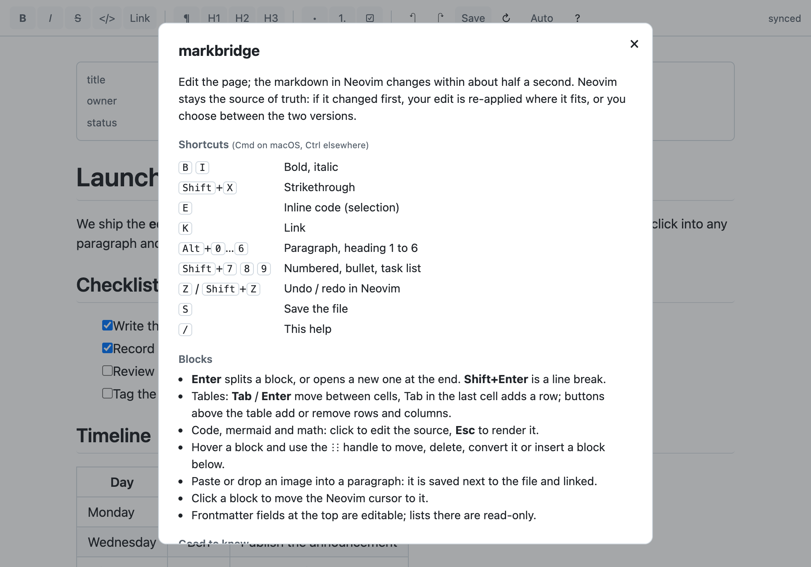
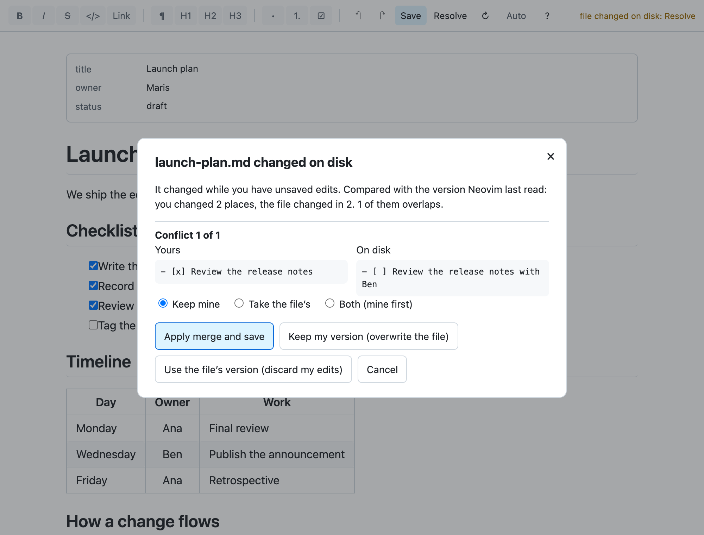
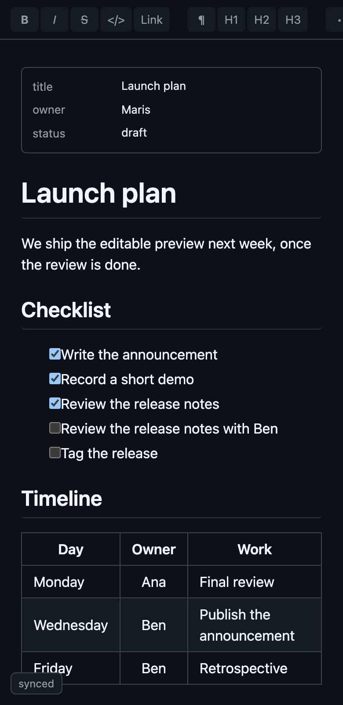

# markbridge.nvim

Edit your markdown in the browser and watch it land in Neovim.

markbridge renders the file you are editing in a real page (diagrams, math, task lists, tables, highlighted code) and lets you **type straight into the rendered text**. Every change is written back to your Neovim buffer as markdown, within about half a second. Edit in Neovim and the page follows.

[More Drumandbytes projects](https://drumandbytes.com/projects/?ref=markbridge.nvim-readme)

<p align="center">
<picture>
  <source media="(prefers-color-scheme: dark)" srcset="docs/screenshots/page-dark.png">
  
</picture>
</p>

## Why

Browser previewers for Neovim are one-way: you read the rendering and go back to the source for every tweak. That is awkward when you co-write a document with a person, or with an AI agent, who wants to click into the rendered text. markbridge closes the loop without taking Neovim out of the middle:

- **Neovim stays the source of truth.** The page edits your buffer; it never owns the file.
- **Edits are patched by line range, one block at a time,** so changing a paragraph never rewrites the rest of your document.
- **Conflicts are handled like a git merge** instead of being clobbered or silently dropped.

## Features

- Edit paragraphs, headings, lists, task items and table cells in place, with a formatting bar and keyboard shortcuts.
- Click a code block, mermaid diagram or `$$` math block to edit its source.
- Frontmatter fields (`key: value`) become inputs; table rows and columns can be added and removed.
- Block menu: move, delete, convert or insert blocks. Paste or drop an image and it is saved next to the file.
- Mermaid, KaTeX math, emoji, syntax highlighting, task lists and GitHub-flavoured tables render out of the box.
- Light, dark or auto theme, configurable.
- Save from the page, undo and redo through Neovim's own undo.
- Changes made to the file by other tools are picked up, and a three-way merge settles real conflicts.
- No Node, no build step, no runtime dependencies: the browser libraries are vendored and checksum-pinned.

<p align="center">
  
  &nbsp;
  
</p>

## Requirements

- Neovim 0.10 or newer. It is developed on 0.12; CI runs the current stable release.
- A browser. It is developed against Chromium-based browsers; Firefox and Safari should work and are on the [manual test list](TESTING.md).
- macOS and Linux are used day to day. Windows is untested.

## Install

With the built-in package manager (Neovim 0.12):

```lua
vim.pack.add { { src = 'https://github.com/drumandbytes/markbridge.nvim', version = vim.version.range '*' } }
require('markbridge').setup {}
```

With lazy.nvim:

```lua
{
  'drumandbytes/markbridge.nvim',
  version = '*',
  cmd = 'Markbridge',
  opts = {},
}
```

Nothing to build. Any other plugin manager that puts the repository on the runtime path works.

## Quick start

1. Open a markdown file in Neovim.
2. Run `:Markbridge`. Your browser opens `http://markbridge.localhost:6274/…`.
3. Click into the page and type. Look at your buffer.
4. `:Markbridge stop` (or just quit Neovim) when you are done.

Try it on the bundled [`examples/demo.md`](examples/demo.md), which has every kind of block.

A mapping to start it:

```lua
vim.keymap.set('n', '<leader>mp', '<Cmd>Markbridge toggle<CR>', { desc = 'Markdown browser preview' })
```

## Commands

| Command | Does |
| --- | --- |
| `:Markbridge` / `:Markbridge toggle` | Start for the current buffer, or stop if running |
| `:Markbridge start` | Start, or retarget to the current markdown buffer, and open the browser |
| `:Markbridge stop` | Stop the server |
| `:Markbridge url` | Print the page URL (it carries a per-session token) |
| `:Markbridge status` | Running or stopped |
| `:Markbridge theme [auto\|light\|dark]` | Show or set the page's default theme; open pages adopt it right away |

Lua: `require('markbridge').start() / .stop() / .toggle() / .url() / .is_running() / .set_theme(name)`. Health check: `:checkhealth markbridge`. Help: `:help markbridge`.

## Configuration

These are the defaults:

```lua
require('markbridge').setup {
  port = 6274,           -- preferred port; a free one is used if it is busy. 0 = always a free one
  open = true,           -- open the browser on start; or a function(url)
  friendly_url = true,   -- open http://markbridge.localhost:<port>; false uses 127.0.0.1
  follow = true,         -- retarget when you enter another markdown buffer
  scroll_sync = true,    -- scroll the page to the block under the Neovim cursor
  watch = true,          -- reload the buffer when the file changes on disk (never over unsaved edits)
  theme = 'auto',        -- page theme: 'auto' (follow the OS), 'light' or 'dark'
  images_dir = 'assets', -- where pasted images go, relative to the markdown file
}
```

## Editing in the browser

| Block | How you edit it |
| --- | --- |
| Paragraphs, headings (`#`), list items, task items, table cells, also inside quotes and lists | Type, use the formatting bar or shortcuts, paste (as plain text), click a task checkbox |
| Fenced code, mermaid, `$$` math | Click to open the source in a text box; the page re-renders when you leave it (Esc) |
| Frontmatter | Flat `key: value` lines are fields at the top of the page; lists and block values stay read-only |
| Enter | Splits the block at the caret; at the end it opens an empty block below. In a table cell, Enter and Tab move between cells and Tab in the last cell adds a row |
| Shift+Enter | A hard line break |
| Tables | Buttons above the focused table add or remove rows and columns after the current cell; column alignment (`:--`, `:-:`, `--:`) stays with its column |
| Images | Paste or drop an image into a paragraph: it is saved to `assets/` next to the file and linked |
| Click a block | Moves the Neovim cursor to its first line |

<p align="center">
  
</p>

Not editable (rendered, but read-only): HTML blocks, indented code, setext headings (a title over `====`), and paragraphs that use reference links, footnotes or `<https://…>` autolinks, because those can't be rebuilt faithfully from the page.

**Shortcuts** (Cmd on macOS, Ctrl elsewhere): `B` bold, `I` italic, `Shift+X` strikethrough, `E` inline code, `K` link, `Alt+0` to `Alt+6` paragraph or heading level, `Shift+7` / `Shift+8` / `Shift+9` numbered, bullet and task list, `S` save, `Z` / `Shift+Z` undo and redo, `/` for the in-page help.

**Top bar.** Formatting, block type and lists, undo and redo (these run Neovim's undo, so browser edits and Neovim edits share one history), Save, refresh (reloads from Neovim and re-reads the file from disk when the buffer has no unsaved edits), the theme button and help.

<p align="center">
  
</p>

### What a browser edit does to your markdown

An edited block is rewritten from the page; everything outside the block is untouched, byte for byte. Inside the block:

- Soft-wrapped lines are kept. Emphasis normalises to `*x*` and `**x**`, and some characters get escaped (`2 * 3` becomes `2 \* 3`).
- Tables are re-padded.
- Math (`$x$`), emoji (`:smile:`) and inline HTML round-trip: editing text around them writes their source back unchanged.

## Keeping in sync

Neovim's buffer is the source of truth, and nothing is overwritten without you choosing it.

- **You edit in the page while Neovim changed something else.** The page reloads from Neovim and re-applies your edit where its block now is. Nothing to do.
- **You edit a block that Neovim changed too.** A dialog shows your version next to Neovim's: keep Neovim's, use yours, or copy yours.
- **The file changed on disk** (another tool, another person, an AI agent):
  - If the buffer is clean, a file watcher reloads it and the page follows.
  - If the buffer has unsaved edits, markbridge keeps them and offers **Resolve**. It does a three-way merge against the version Neovim last read. Changes in different places combine on their own; overlapping changes are listed, and for each you pick *mine*, *the file's* or *both*. The result is written as one undo step.

<p align="center">
  
</p>

- **Undo** is Neovim's: one browser edit is one undo step.
- **Saving** is the Save button, Cmd/Ctrl+S, or `:w`. Saving from the page refuses to overwrite a file that changed on disk and opens Resolve instead. A buffer without a file name needs `:w <name>` first.
- **Several buffers:** with `follow` the preview retargets to whichever markdown buffer you enter. Closing the previewed buffer stops the server.

## Themes

Auto follows the OS and switches with it; light and dark force a theme. `theme` sets the default and the button in the top bar overrides it per browser (remembered). `:Markbridge theme dark` wins again whenever the Neovim-side setting changes. Mermaid diagrams and code highlighting follow the theme. The page is responsive: the top bar scrolls on narrow windows.

<p align="center">
  
</p>

## Security and privacy

- The server listens on `127.0.0.1` only, on port 6274 (or a free port when that is busy). The page opens at `markbridge.localhost`, which browsers resolve to your own machine; `friendly_url = false` uses the bare IP.
- Every request that reads or writes the buffer needs a random per-session token in an `X-Token` header (a custom header, so another website can't send it cross-origin). Requests must also carry our own `Host` (`<label>.localhost`, `localhost` or `127.0.0.1` on our port), which defends against DNS rebinding.
- Images are served only from the previewed file's folder, with a same-origin resource policy. Request bodies over 25 MB are refused.
- No telemetry, no network access beyond your machine: the browser libraries are vendored in the repository.

Report a vulnerability as described in [SECURITY.md](SECURITY.md).

## Limitations

- One preview server per Neovim instance; a second Neovim falls back to another port.
- Markdown flavour is CommonMark plus GitHub-style tables and task lists, emoji, `$…$` / `$$…$$` math, mermaid and flat frontmatter. Footnotes and definition lists are not rendered.
- Not everything is editable in the page (see above); edit those parts in Neovim.
- Browser edits change the buffer, not the file, until you save.
- Pre-1.0: details, including configuration, may still change between minor versions.

## Troubleshooting

- **"nvim preview stopped" in the page:** the Neovim session ended. Start it again and open the new URL.
- **The browser can't resolve `markbridge.localhost`:** set `friendly_url = false`.
- **Port in use:** markbridge falls back to a free port and prints it; `:Markbridge url` shows the current URL.
- **Over SSH:** the server runs where Neovim runs. Forward the port (`ssh -L 6274:localhost:6274 host`), start with `open = false`, and open the printed URL locally.
- **Nothing happens on `:Markbridge`:** the buffer must have the `markdown` filetype. `:checkhealth markbridge` checks the rest.
- **"nvim changed first" or a conflict dialog:** you and Neovim edited the same block. See *Keeping in sync*.

## Documentation

- [How it works](docs/how-it-works.md): architecture, the block model, the HTTP protocol and the merge.
- [Contributing](CONTRIBUTING.md): development setup, tests, vendored libraries, releases.
- [Testing](TESTING.md): the manual browser checklist.
- [Third-party code](THIRD_PARTY.md): vendored libraries and licenses.
- [Changelog](CHANGELOG.md).

## License

MIT, see [LICENSE](LICENSE).
