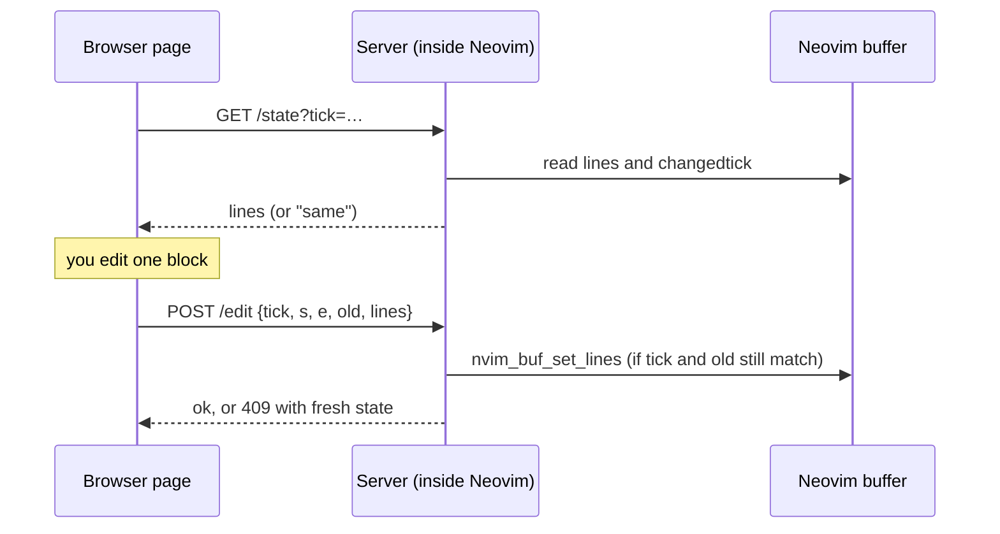

# How it works

markbridge is a small HTTP server inside Neovim plus a static page. There is no separate process, no Node and no build step.

## Pieces

| Path | Role |
| --- | --- |
| `lua/markbridge/init.lua` | Config, commands, buffer state, the API handlers, the file watcher, conflict resolution |
| `lua/markbridge/server.lua` | The TCP/HTTP server on `127.0.0.1`: parsing, static files, images, size limits |
| `lua/markbridge/merge.lua` | The three-way merge (pure functions on line lists) |
| `lua/markbridge/health.lua` | `:checkhealth markbridge` |
| `plugin/markbridge.lua` | The `:Markbridge` command |
| `web/core.js` | Markdown to DOM and back: block ranges, escaping, tables, conversions. No UI, no network, so it runs under node in the tests |
| `web/app.js` | The page: polling, editing, toolbar, menus, dialogs |
| `web/index.html` | Markup and styles (tokens for light and dark) |
| `vendor/` | markdown-it, KaTeX, highlight.js, Mermaid, github-markdown-css, pinned and checksummed |

## The block model

markdown-it reports the source line range of every block. `core.js` adds those ranges to the rendered elements (`data-s` start, `data-e` end) and decides which blocks are editable (`kind`): top-level and nested paragraphs, `#` headings, list items (a parent item edits only its own lines, before its nested list), tables, closed fenced code and `$$` blocks.

When you edit a block, `core.js` converts just that element's DOM back to markdown (`build`), keeping the line prefix (list marker, quote `>`, indent) of the original. The page then sends the old lines and the new lines for that range. Everything outside the range is never touched. Constructs that cannot be rebuilt faithfully (reference links, footnotes, autolinks, setext headings, HTML blocks, indented code) are not made editable.

## The protocol

All requests except the static files need the session token in an `X-Token` header, and a `Host` of our own origin.

| Request | Does |
| --- | --- |
| `GET /` | The page (needs `?t=<token>`); the file name goes into `<title>` |
| `GET /web/…`, `GET /vendor/…` | Static assets, whitelisted directories only |
| `GET /<image>` | Images from the previewed file's folder |
| `GET /state?tick=&id=` | The buffer (or `same`), plus theme, cursor line, `modified`, `disk_changed` |
| `POST /edit` | Replace `lines[s, e)` with `lines` if `tick`, buffer id and `old` still match; else 409 with the fresh state |
| `POST /cursor` | Move the Neovim cursor to a line |
| `POST /undo`, `POST /refresh` | Neovim undo and redo; re-read the file when the buffer is clean |
| `POST /save` | `:write` (refused for a nameless buffer or a file changed on disk) |
| `POST /image` | Save a pasted image under `images_dir` |
| `GET /merge`, `GET /diff`, `POST /resolve` | The disk-conflict flow |

## Keeping the two sides in step

- The page polls `/state` twice a second with the buffer's `changedtick`; nothing is pushed.
- An edit carries the tick it was made against. If Neovim changed since, the server answers 409 with the fresh buffer. The page then looks for the edited block's old lines in it: found means the edit is re-applied there, not found means the conflict dialog.
- A directory watcher on the file's folder (a file watch would die when a tool replaces the file by rename) runs `:checktime`. A clean buffer reloads; a modified one is flagged.
- For the flagged case markbridge keeps the file as Neovim last read or wrote it per buffer (`BufReadPost`, `BufWritePost`, `FileChangedShellPost`), and `merge.lua` runs a classic diff3 with `vim.diff` hunks: changes from the base to each side, clustered where they overlap. Only clusters where the two sides differ become conflicts.

## Testing

- `npm test`: the conversion logic under jsdom, with unedited round trips for every supported construct.
- `nvim --headless -u NONE -l test/merge_spec.lua`: the merge.
- `nvim --headless -u NONE -l test/server_spec.lua`: the server end to end against a real buffer, with curl.
- `TESTING.md`: what only a real browser can check (contenteditable behaviour differs between engines).
