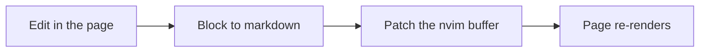

# Launch plan

We ship the **editable preview** next week. This page is the checklist, and you can *edit it right here*: click into any paragraph and type, and the change lands in your Neovim buffer.

## Checklist

- [x] Write the announcement
- [x] Record a short demo
- [ ] Review the release notes
- [ ] Tag the release

## Timeline

| Day       | Owner | Work                      |
| --------- | :---: | ------------------------- |
| Monday    |  Ana  | Final review              |
| Wednesday |  Ben  | Publish the announcement  |
| Friday    |  Ana  | Retrospective             |

## How a change flows



Growth per week is roughly $g = (1 + r)^t$, and the install snippet is:

```lua
vim.pack.add { 'https://github.com/drumandbytes/markbridge.nvim' }
```
